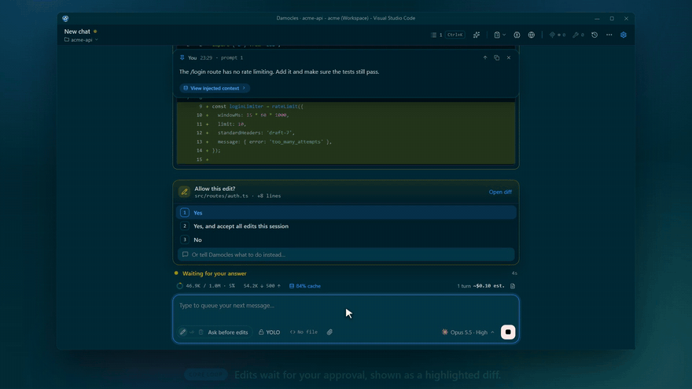

<div align="center">
  
  <h1>Damocles</h1>
  <p>An AI coding assistant, just keep in mind that just because something works doesn't mean it's good.</p>
</div>

Damocles is a desktop app for Windows, macOS and Linux that runs an AI coding agent on the [pi](https://github.com/earendil-works/pi) agent engine. The app puts your projects and chats in a sidebar beside an editor, terminals, search and source control, and connects to SSH hosts, WSL distros and dev containers. The agent helps with coding, debugging and refactoring, and talks to Anthropic, OpenAI, GitHub Copilot and other model providers directly.

Damocles is also a VS Code extension. The extension runs the same agent, chat and tools as the desktop app, and the two share conversations, memory, settings and pi sign-ins through `~/.damocles`.

## Demo

<div align="center">
  <a href="docs/media/damocles-demo.mp4">
    
  </a>
  <p><em>Diff approval, live shell output, switching a panel's workspace folder, subagents with /steer, teams and /stats. <a href="docs/media/damocles-demo.mp4">Watch the full video</a>, which also covers plan mode, stop and resume, and rewind.</em></p>
</div>

## Features

- **Desktop app**: projects and chats in a sidebar, plus an editor with HTML preview, terminals, search and source control. See [Desktop app](docs/desktop-app.md).
- **Remote development**: SSH hosts, WSL distros and dev containers from the desktop app. See [Remote development](docs/remote-development.md).
- **Chat**: sidebar or editor panels with diff approval, live shell output, tool overlays, a prompt navigator and session history. See [Chat interface](docs/chat.md).
- **Context and cost**: a context ring, `/context`, `/usage` for subscription limits and `/stats` for spend across projects. See [Context stats](docs/chat.md#context-stats).
- **Models**: Anthropic, OpenAI, GitHub Copilot, StepFun, DeepSeek, MiniMax, xAI, Kimi Code and Meta models, picked per panel with per-model reasoning effort. See [Models](docs/models.md).
- **Agents and teams**: custom agent templates, background subagents, `/steer`, resume after an interruption, and teams of 2-5 specialists. See [Agents and teams](docs/agents.md).
- **Plan mode**: the agent writes a plan to a per-session file and waits for your approval before it changes anything. See [Plan mode](docs/plan-mode.md).
- **Design mode**: the agent designs in a linked design chat that writes only its design folder, checks each screen against your components and tokens, and sends you an approved version to plan against. See [Design mode](docs/design-mode.md).
- **Checkpoints and rewind**: roll back files, fork a conversation into a new panel, or rewind to before a compaction. See [Checkpoints](docs/checkpoints.md).
- **Compaction and caching**: manual and automatic compaction with per-model budgets, and prompt cache warming. See [Compaction](docs/compaction.md).
- **Permissions**: per-panel modes, YOLO, and allow, deny and ask rules compatible with Claude Code's settings files. See [Permissions](docs/permissions.md).
- **Hooks**: your own commands before and after tools, on prompt submit, on completion and when approval is needed. See [Hooks](docs/hooks.md).
- **Persistent memory**: facts, preferences, episodes and observations in SQLite, extracted automatically and injected when relevant. See [Persistent memory](docs/persistent-memory.md).
- **Compass**: an opt-in tree-sitter code graph with search, blast radius, review context and dead-code tools. See [Compass](docs/compass.md).
- **Browser**: an opt-in Patchright browser the agent drives, shown in editor tabs. See [Browser](docs/browser.md).
- **MCP**: servers from eight config sources, with per-tool exposure, resources, OAuth and elicitation. See [MCP servers](docs/mcp.md).
- **Web tools and image generation**: opt-in key-free web search and fetch, `GenerateImage`, and deferred tool loading. See [Tools](docs/tools.md).
- **Mentions, commands and skills**: `@` files and agents, built-in and custom `/` commands, and skills from `.damocles`, `.claude` and `.codex`. See [Using Damocles](docs/usage.md).
- **Voice input**: push-to-talk cloud transcription or an on-device "Hey Jarvis" wake word. See [Voice input](docs/usage.md#voice-input).
- **Localization**: the UI is in English and Greek. See [Localization](docs/configuration.md#localization).

## Requirements

- **Desktop app**: macOS 13 or later (Apple Silicon), Windows 10 or later, current 64-bit Linux distributions. See [Install the desktop app](#install-the-desktop-app)
- **VS Code extension**: VS Code 1.95.0 or higher
- For Claude models: a Claude subscription (Pro, Max, Team, Enterprise) **or** an `ANTHROPIC_API_KEY`. See [Authentication](#authentication)
- For GPT models: a ChatGPT subscription **or** an OpenAI API key
- For StepFun / DeepSeek / MiniMax / xAI / Kimi Code / Meta models: the respective provider API key or sign-in (set in their Settings panels)
- **Supported platforms**: Windows, macOS, and Linux. Memory and Compass use Node's built-in `node:sqlite` (no native modules or WASM), so there is nothing to compile per platform. Voice's wake-word mode and spoken replies run a separate Python sidecar on Windows x64, Linux x64 and macOS arm64 only (see the [voice guide](docs/voice-jarvis-mode.md))

## Installation

### Install the desktop app

Download the app from the assets of the [latest release](https://github.com/AizenvoltPrime/damocles/releases/latest). Supported systems are macOS 13 (Ventura) or later on Apple Silicon, Windows 10 or later, and current Linux distributions. Only 64-bit builds exist: x64 and arm64 on Windows and Linux, arm64 on macOS.

| System | Download | Install |
| --- | --- | --- |
| Windows x64 or arm64 | `Damocles-Setup-<version>-x64.exe` or `Damocles-Setup-<version>-arm64.exe` | Run it. It installs for your user only, needs no administrator rights, and starts the app. |
| macOS (Apple Silicon) | `Damocles-<version>-arm64.dmg` | Open it and drag Damocles to Applications, then approve it as described in [macOS approval](docs/desktop-app.md#macos-approval). |
| Debian, Ubuntu (x64 or arm64) | `damocles_<version>_amd64.deb` or `damocles_<version>_arm64.deb` | `sudo apt install ./damocles_<version>_amd64.deb` |
| Fedora, RHEL (x64 or arm64) | `damocles-<version>.x86_64.rpm` or `damocles-<version>.aarch64.rpm` | `sudo dnf install ./damocles-<version>.x86_64.rpm` |

Every release lists the SHA-256 of each attached file in `SHA256SUMS`, and every attached file except `SHA256SUMS` has a GitHub build provenance attestation that ties it to the release workflow run that built it. To verify a download, run these in the folder you downloaded to:

```bash
sha256sum -c SHA256SUMS --ignore-missing
gh attestation verify Damocles-Setup-<version>-x64.exe --repo AizenvoltPrime/damocles
```

Windows SmartScreen warnings, macOS Gatekeeper approval, the Linux sandbox, corporate proxies and updates are covered in [Desktop app](docs/desktop-app.md).

### VS Code extension

1. Clone the repository.
2. Run `npm install` with Node.js 24.16 or later.
3. Run `npm run build`.
4. Press F5 in VS Code to launch the Extension Development Host.

To install a packaged `.vsix` instead, see [Development](docs/development.md#packaging-the-extension).

## Authentication

Sign in from Settings › Models & accounts, opened by the gear in the chat header (VS Code) or in the title bar (desktop app). Damocles keeps its own credentials under `~/.damocles/`, separate from the Claude Code CLI.

| Provider | How to sign in |
| --- | --- |
| Claude (Anthropic) | An API key, or **Sign in with Claude** for a subscription in extra usage or allowance mode |
| OpenAI | **Sign in with ChatGPT**, or an OpenAI API key |
| GitHub Copilot | **Sign in with GitHub** |
| xAI, Kimi Code, Meta, OpenRouter | An API key, or the provider's sign-in button |
| StepFun, DeepSeek, MiniMax, TypeSafe | An API key |

The Claude "allowance" mode very likely violates Anthropic's Terms of Service; read the warning in [Authentication](docs/authentication.md#claude-anthropic) before you use it. Billing, key precedence and each provider's details are in [Authentication](docs/authentication.md).

### Desktop credential storage

The desktop app encrypts the secrets you save (MCP sign-ins, the OpenAI API key, the OpenRouter, TypeSafe, StepFun, DeepSeek, MiniMax, xAI, Kimi Code, Meta and voice keys) with your operating system's credential store and keeps the encrypted file, `secrets.json`, in its data folder. When it cannot reach that store, it keeps secrets in memory only, tells you so the first time you save one, and you have to enter them again after a restart.

- **Windows:** the Data Protection API (DPAPI) of your Windows account. It is always available, so there is nothing to set up.
- **macOS:** the login keychain, as the "Damocles Safe Storage" item. If macOS asks whether Damocles may use it, choose **Always Allow**. If you denied access, open Keychain Access, find "Damocles Safe Storage" and allow Damocles under **Access Control**, or delete the item so the app creates it again.
- **Linux:** a Secret Service provider through libsecret (GNOME Keyring, KeePassXC with Secret Service enabled, and similar) or KDE's KWallet. Install one (for example `sudo apt install gnome-keyring` or `sudo dnf install gnome-keyring`), make sure it starts and is unlocked with your desktop session, then restart Damocles. The app picks the store that matches your desktop; to choose one yourself, start it with `--password-store=gnome-libsecret`, `--password-store=kwallet5` or `--password-store=kwallet6`. Without either, Chromium would fall back to a fixed built-in key, which is not encryption, so Damocles keeps secrets in memory instead.

## Configuration

Every `damocles.*` setting is listed in [Configuration](docs/configuration.md). Permission rules live in `.damocles/settings.json` files ([Permissions](docs/permissions.md)) and MCP servers in `mcp.json` files ([MCP servers](docs/mcp.md)).

Hooks run your own command at key moments in a session. Put them in `~/.damocles/hooks.json`, or in `<workspace>/.damocles/hooks.json` for a trusted workspace:

```jsonc
{
  "hooks": {
    "tool_call": [
      // Block destructive shell commands: emit a deny JSON when the command matches.
      { "match": "Bash",
        "command": "in=$(cat); echo \"$in\" | jq -e -r '.input.command | test(\"rm -rf\")' >/dev/null && echo '{\"decision\":\"deny\",\"reason\":\"Refusing rm -rf\"}'" }
    ],
    "permission_required": [
      { "command": ["uv", "run", "${workspaceFolder}/.damocles/hooks/notify.py", "--notify"] }
    ]
  }
}
```

The event table, the stdin and stdout contract and worked examples are in [Hooks](docs/hooks.md).

## Development

```bash
npm install         # install dependencies
npm run build       # build extension and webview
npm run dev         # watch mode
npm run typecheck   # type check
npm test            # run tests
npm run dist        # build the desktop app installer for this platform into dist-desktop/
npm run dist:local  # same, plus all eight remote server packages, for a build with no GitHub release
```

A `dist:local` build installs remote servers only from its own server cache, so run it on the computer that runs the app and install what it makes there. A plain `npm run dist` build installs on no remote host. Details are in [Packaging the desktop app](docs/development.md#packaging-the-desktop-app).

Packaging the `.vsix`, smoke tests and the architecture are in [Development](docs/development.md). The release workflow is in [Releasing Damocles](docs/release.md).

## Code signing policy

Windows releases are signed. Free code signing is provided by [SignPath.io](https://about.signpath.io/), certificate by [SignPath Foundation](https://signpath.org/).

Team roles: Authors, Reviewers and Approvers are all [AizenvoltPrime](https://github.com/AizenvoltPrime), the sole maintainer.

Signed files: `Damocles.exe`, `ssh-askpass.exe` (the SSH password prompt helper, compiled from `resources/askpass/ssh-askpass.cs`), `browser.exe` (the Windows remote server's link helper, compiled from `resources/server-bin/helpers/browser.c`) and the Windows installers, each built by this repository's release workflow from a tagged commit. Each signing request is approved by hand. The open source components the app includes (Electron's libraries, ripgrep, koffi, node-pty) ship as their projects publish them and are not signed by this project.

macOS builds are signed ad hoc, and Linux packages are not signed. The procedure is in [docs/desktop-signing.md](docs/desktop-signing.md).

**Privacy statement.** Damocles collects no telemetry, crash reports or analytics. It sends your prompts and files to the model providers you configure, and connects to the MCP servers, web tools and voice services you turn on. A provider sign-in (Sign in with Claude, ChatGPT, xAI, Kimi Code, Meta, OpenRouter or GitHub) contacts that provider's sign-in endpoints, such as `auth.x.ai` for xAI, `auth.kimi.com` for Kimi Code, and `auth.meta.com` and `api.meta.ai` for Meta; Sign in with GitHub contacts `github.com` (or your GitHub Enterprise domain) and GitHub Copilot's API, which also turns on the models your Copilot plan allows; Sign in with OpenRouter opens `openrouter.ai` and exchanges the approval for a key there. With a Claude subscription sign-in, `/usage` also reads your account profile from Anthropic (`api.anthropic.com/api/oauth/profile`). With image generation turned on, `GenerateImage` sends the agent's image prompt to OpenRouter. With an OpenRouter key or sign-in set, at startup, when the key changes and after a sign-in, Damocles asks OpenRouter which models the key may use (`openrouter.ai/api/v1/models/user`) and downloads pi's OpenRouter model list from pi.dev (`pi.dev/api/models/providers/openrouter`). With a TypeSafe key or an OpenRouter key or sign-in set, the memory judges send memory text and your prompt to TypeSafe's Jev classifier, directly or through OpenRouter; with neither and an OpenAI API key, or when you choose it, to OpenAI's Decisions API (GPT-6 Luna). The desktop app also contacts GitHub (github.com and its release download servers) at startup, every 4 hours and after the computer wakes to check for a newer release, and on Windows and Linux to download it; Settings › About › Check for updates automatically turns those checks off, leaving only the checks you ask for. For remote development (see "[Remote development](docs/remote-development.md)"), the desktop app connects over SSH, through your OpenSSH client, only to the hosts you connect to, and sends them what "[What reaches the target](docs/remote-development.md#what-reaches-the-target)" lists; forwarded ports travel inside that connection. A host downloads the Damocles server package from this project's GitHub releases; when it cannot, and for a WSL distro or a dev container on this computer, the desktop app downloads the package from GitHub itself. Opening a dev container runs the Dev Containers CLI, which pulls the images and Features its configuration names. It sends nothing else to any networked system unless you ask it to.

## Documentation

| Document | Covers |
| --- | --- |
| [Using Damocles](docs/usage.md) | Keyboard shortcuts, IDE context, attachments, `@` mentions, slash commands, skills, instructions files, voice and per-panel folders |
| [Chat interface](docs/chat.md) | Messages, diffs, tool cards and overlays, sessions, context stats, `/usage` and `/stats` |
| [Models](docs/models.md) | Available models, per-panel selection, reasoning effort and effort badges |
| [Authentication](docs/authentication.md) | Signing in to each provider, billing and key precedence |
| [Agents and teams](docs/agents.md) | Subagents, custom agents, steering, resuming and collaborative teams |
| [Plan mode](docs/plan-mode.md) | Plan files, what runs while planning, approval and binding a plan |
| [Design mode](docs/design-mode.md) | Design chats, the design folder, checks, versions and approval, the desktop preview, Open in browser and DesignParity |
| [Checkpoints](docs/checkpoints.md) | File checkpoints, rewind, forking and rewinding to before a compaction |
| [Compaction](docs/compaction.md) | Manual and automatic compaction, per-model budgets and prompt cache warming |
| [Permissions](docs/permissions.md) | Permission modes, YOLO and allow, deny and ask rules |
| [Hooks](docs/hooks.md) | `hooks.json` format, events, the stdin and stdout contract and examples |
| [Persistent memory](docs/persistent-memory.md) | Memory kinds and scopes, extraction, injection, judges, tools and panels |
| [Compass](docs/compass.md) | The workspace knowledge graph and its tools |
| [Browser](docs/browser.md) | The integrated browser, its agent tools and limits |
| [MCP servers](docs/mcp.md) | Config sources, fields, tool exposure, resources, OAuth and elicitation |
| [Tools](docs/tools.md) | Web tools, image generation, deferred tool loading and the Tools panel |
| [Configuration](docs/configuration.md) | Every `damocles.*` setting and localization |
| [Desktop app](docs/desktop-app.md) | Installing, updates, projects and chats, editor, terminals, source control and shared data |
| [Remote development](docs/remote-development.md) | SSH, WSL and dev container targets, what reaches a host and the `damocles` command |
| [Worktree isolation](docs/worktree-isolation.md) | Rules that keep a worktree chat out of its project folder |
| [Jarvis mode](docs/voice-jarvis-mode.md) | On-device wake-word voice input: setup, engines, privacy and troubleshooting |
| [Slash commands](docs/slash-commands.md) | Custom slash command files: locations, arguments, frontmatter and unsupported features |
| [Development](docs/development.md) | Building from source, commands, packaging and architecture |
| [Releasing Damocles](docs/release.md) | The release workflow, verification and publishing |
| [Desktop code signing](docs/desktop-signing.md) | SignPath signing for Windows and the macOS signing plan |
| [Invariants](docs/invariants.md) | Rationale and failure modes behind each subsystem's rules |
| [Performance baseline](docs/perf.md) | Startup spans, stalls and measured baselines |
